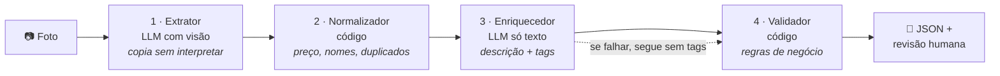

# Cardápio Agente

Transforma a **foto de um cardápio** em um **JSON estruturado** (itens, preços, seções, descrição e tags) e aponta o que precisa de **revisão humana** antes de publicar.

O problema: cadastrar um cardápio à mão leva cerca de **13 minutos** (medido). Nos 6 cardápios avaliados, o pipeline fez o trabalho em cerca de **32 segundos**, achou **91% dos itens** e acertou **94% dos preços**. Quando não tem certeza de um preço, ele não chuta: marca o item para alguém conferir.

[](https://github.com/keitiely/cardapio-agente/actions/workflows/ci.yml)

**Demo:** [cardapio-agente.streamlit.app](https://cardapio-agente.streamlit.app), com 3 cardápios já processados para ver na hora, sem gastar cota.

<!-- GIF da demo entra aqui -->

## Como funciona

Um **workflow** de 4 etapas, não um agente autônomo. Cada etapa tem uma tarefa só, e é o código, não a IA, que decide o que é aceito.



| Etapa | O que faz | Por que assim |
|---|---|---|
| **Extrator** | Copia o texto da foto: nome, preço como está escrito, seção e descrição. | Separar "ler" de "interpretar" deixa claro de onde vem cada erro. |
| **Normalizador** | `"R$ 1.200,00"` → `1200.0`, `"X-BURGUER"` → `"X-Burguer"`, remove numeração e duplicados. P/M/G na mesma linha fica sem preço. | É regra fixa: código é mais barato, rápido e previsível que IA. |
| **Enriquecedor** | Sugere descrição curta e tags de uma **lista fechada** (vegano, sem glúten, frito…). Mantém a descrição original quando existe. | O Pydantic recusa qualquer tag fora da lista. A etapa é opcional: se falhar, o cardápio sai sem tags. |
| **Validador** | Aponta preço ausente, preço fora de R$ 0,50–R$ 1.000, nome repetido e tags que se contradizem (vegano + contém lactose). | Não tenta consertar: diz o que um humano precisa olhar. |

**Provedores:** Gemini (padrão, camada gratuita) ou Claude, trocando só a variável `PROVEDOR`. Se o modelo principal estiver sobrecarregado, o código tenta um modelo reserva.

## Resultados

Avaliação em **6 cardápios** com gabarito, comparando item a item (nomes pareados com similaridade ≥ 0,8).

| Cardápio | Itens | Cobertura | Precisão | Preço certo | Categoria certa | Agente | Manual (estimado) |
|---|---|---|---|---|---|---|---|
| caseiro | 17 | 100% | 100% | 100% | 100% | 30 s | 13,2 min |
| doces | 25 | 100% | 100% | 100% | 100% | 65 s | 19,4 min |
| restaurante | 21 | 100% | 100% | 100% | 100% | 13 s | 16,3 min |
| salgados | 18 | 100% | 100% | 67% | 100% | 37 s | 14,0 min |
| self-service | 11 | 46% | 83% | 100% | 100% | 40 s | 8,5 min |
| tapiocas | 9 | 100% | 100% | 100% | 100% | 6 s | 7,0 min |
| **Média** | | **91%** | **97%** | **94%** | **100%** | **32 s** | **13,1 min** |

- **Cobertura:** dos itens do gabarito, quantos o sistema encontrou. **Precisão:** dos itens devolvidos, quantos existem de verdade.
- **Tempo manual:** digitar 5 itens à mão (nome, preço e seção) levou 3 min 53 s, cerca de 47 s por item, multiplicado pelo número de itens de cada cardápio. É uma estimativa, não uma medição de cada cardápio.
- **Gabaritos:** transcritos das fotos com ajuda do Claude, um modelo diferente do avaliado (Gemini 3.6 Flash), e revisados à mão. Nenhum gabarito foi alterado depois de ver os resultados.
- Os dados estão em [`evals/`](evals/): fotos, gabaritos, saídas salvas e o [relatório](evals/saidas/relatorio.json).

### Onde o sistema errou

1. **Preço em grupo (salgados).** Um único "R$ 75,00 / 100 unidades" vale para 6 itens. Como o texto tem dois números, o Normalizador não escolhe um: os 6 itens vão para revisão humana com o motivo. É o comportamento desejado (não chutar), mas conta como erro de preço na métrica.
2. **Itens sem preço (self-service).** Acompanhamentos listados sem preço (arroz, feijão, farofa…) foram ignorados, e a descrição do suco entrou no nome. O pior: o cardápio **não** foi marcado para revisão, porque o Validador só confere o que foi extraído. Um item que some em silêncio é o erro mais perigoso deste sistema.

## Rodar localmente

Precisa de Python 3.11+ e de uma [chave gratuita do Gemini](https://aistudio.google.com/apikey).

```bash
git clone https://github.com/keitiely/cardapio-agente.git
cd cardapio-agente
python3.11 -m venv .venv && source .venv/bin/activate
pip install -r requirements.txt
cp .env.example .env   # coloque sua GEMINI_API_KEY no .env
```

```bash
streamlit run streamlit_app.py                     # interface web
python -m pipeline.orquestrador foto.jpg           # uma foto pelo terminal
python -m evals.rodar_evals                        # avaliação (usa saídas salvas)
python -m evals.rodar_evals --refazer              # avaliação chamando a API de novo
pytest                                             # testes
```

A camada gratuita do Gemini permite cerca de 20 chamadas por dia por modelo, e cada foto usa 2. Por isso a demo mostra exemplos já processados e limita fotos novas por visitante e por dia.

## Testes

**85 testes**, nenhum chama a API (o LLM é substituído por um falso e as chaves são apagadas do ambiente). Rodam no GitHub Actions a cada push e pull request.

Cobrem os formatos de preço brasileiros, os casos que vão para revisão humana, a queda do Enriquecedor sem derrubar o resultado, a troca para o modelo reserva quando o principal está lotado, a recusa de tags inventadas, as métricas dos evals e a abertura do app.

## Estrutura

```
pipeline/        as 4 etapas, o orquestrador e os adaptadores de LLM
  schemas.py     contratos entre as etapas (Pydantic) e a lista fechada de tags
  llm.py         Gemini e Claude atrás da mesma interface
evals/           fotos, gabaritos, métricas e relatório
tests/           testes sem chamadas à API
streamlit_app.py interface: Demo, Resultados e Como funciona
```

## Limitações e próximos passos

- **Itens que somem não são detectados.** Uma segunda leitura só para contar itens por seção permitiria avisar quando o número não bate.
- **Preço em grupo e por tamanho (P/M/G)** sempre vão para revisão. Dá para ensinar o Normalizador a ignorar "100 unidades" e a gerar um item por tamanho.
- **6 cardápios é pouco** para conclusões fortes; os números mostram onde olhar, não a taxa de erro em produção.
- **Privacidade:** na camada gratuita, o Google pode usar as imagens enviadas. A demo pede que só fotos de cardápio sejam enviadas.

---

Feito por [Keitiely Silva Viana](https://github.com/keitiely).
